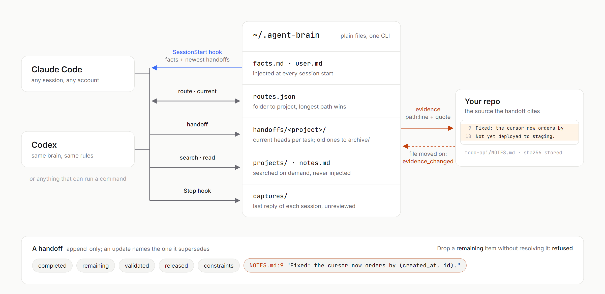
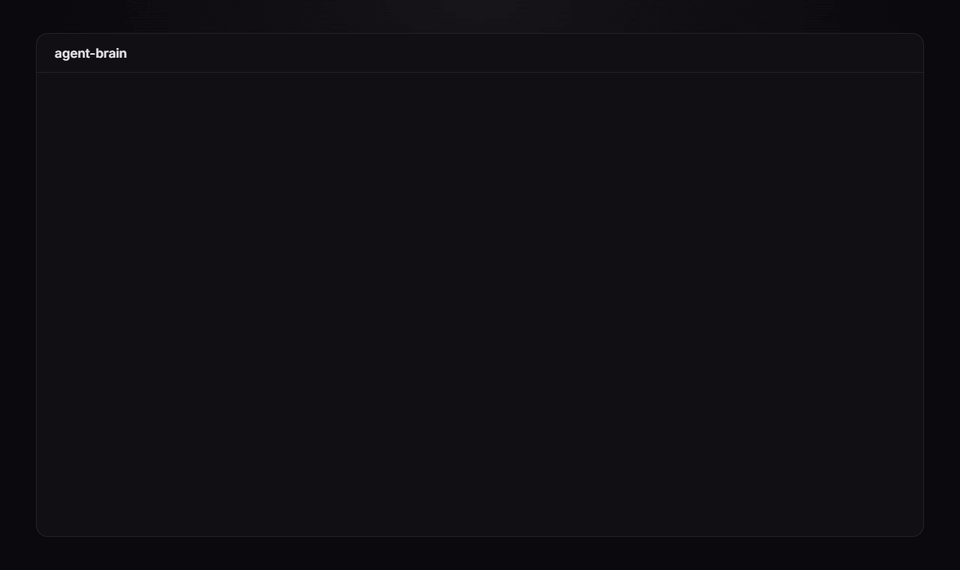

# agent-brain

One shared, source-linked memory for coding agents. Claude Code and Codex (and anything else that can run a
command) read and write the same folder, so a session picks up where the last one stopped, even when the last
one was a different tool.

Python standard library only. No model calls, no embeddings, no network, no service to run.

<picture>
  <source media="(prefers-color-scheme: dark)" srcset="docs/how-it-works-dark.png">
  
</picture>

## The problem

Coding agents forget. Every new session starts cold, and the usual fixes make it worse in quieter ways:

- **Each tool keeps its own memory.** Claude Code has one, Codex has another, and neither sees what the other
  decided yesterday.
- **Notes drift into fiction.** A session writes "pagination fixed" and the next one believes it. Nothing ties
  the claim to the file and line that supports it, or notices when that file changed.
- **"Done" swallows the details.** Work that was implemented, work that was tested, and work that was shipped
  all collapse into one word. The unfinished item from three sessions ago quietly disappears.
- **Memory turns into a dump.** Paste whole transcripts into context and you pay for it on every turn, while the
  one fact that mattered gets buried.

## What this does

agent-brain is a small folder of plain files plus one CLI.

- **Routing.** A registry maps folders to projects (`source`, `task`, `staging`, `worktree`, `historical`), by
  longest matching path. Real git worktrees are found through their common git dir. Unknown folders stay
  unmapped; nothing is guessed from folder names.
- **Current handoffs.** At the end of meaningful work an agent saves a handoff: objective, overview, and five
  separate lists: `completed`, `remaining`, `validated`, `released`, `constraints`. Handoffs are append-only.
  An update names the handoff it `supersedes`; superseded ones move to `archive/` and stay searchable. Several
  tasks in one project stay visible side by side; two heads of the same task are flagged as a conflict.
- **Nothing silently disappears.** An update that drops a previous `remaining` item or `constraint` is
  rejected unless it says explicitly that the item was resolved (or parks it).
- **Source-linked evidence.** Every handoff cites at least one `path` + `line` + exact `quote`. The tool checks
  the quote is really on that line and stores the file's hash. Later, `current` reports `evidence_changed`
  when the cited file has moved on, so the next session reads the live source instead of trusting the note.
- **Session hooks.** A SessionStart hook injects a bounded context: the route, your short facts and
  preferences, and the newest handoff overviews, under a character budget. Sections that do not fit are
  named, never cut mid-text. A Stop hook stores the session's final reply as **unreviewed** evidence: a turn
  ending is never treated as a completion claim.
- **Bounded retrieval.** `search` is lexical over one project's registered files and handoffs, current
  handoffs ranked first, paginated, capped at about 6,000 characters per call. `read` returns exact lines with
  a cursor and refuses paths outside the project.

## Five-minute quickstart

Needs Python 3.9+ and git. Nothing to install for the tour.

```bash
git clone https://github.com/VyasSathya/agent-brain
cd agent-brain
alias brain="python -m agent_brain --brain examples/tiny-brain"
```

PowerShell: `function brain { python -m agent_brain --brain examples/tiny-brain @args }`

The example brain (`examples/tiny-brain`) knows one project, `examples/todo-api`, whose `NOTES.md` records a
pagination bug and its fix.



**1. Route a folder.** Any folder inside the project resolves to it:

```bash
brain route --cwd examples/todo-api/src
# {"project": "todo-api", "role": "source", ...}
```

**2. See what an agent sees at session start:**

```bash
brain startup --cwd examples/todo-api
```

**3. Save a handoff.** `examples/handoff.example.json` keeps work done, work checked and work shipped apart,
and cites two lines of `NOTES.md` (relative evidence paths resolve against the handoff file):

```bash
brain handoff --file examples/handoff.example.json
```

**4. Ask what is current:**

```bash
brain current --project todo-api
# one task, 2 remaining, evidence_changed: false
```

**5. Search and read:**

```bash
brain search --project todo-api --query "duplicate rows"
brain read --project todo-api --path examples/todo-api/NOTES.md --line 9 --count 2
```

**6. Try to cheat.** Save the same handoff again without saying what it replaces:

```bash
brain handoff --file examples/handoff.example.json
# agent-brain error: Task cursor-pagination already has current handoff(s) [...]; list them in "supersedes" ...
```

Add `"supersedes": ["<id>"]` and delete one `remaining` item, and it is refused again until you move that
item into `resolved_previous` or `parked`.

**7. Change the source.** Append a line to `examples/todo-api/NOTES.md`, then run `brain current --project
todo-api` again: `evidence_changed` is now `true`.

(The tour writes into `examples/tiny-brain/handoffs/`, which git ignores. `git clean -fdX examples` resets it.)

## Your own brain

```bash
pip install .                      # or keep using python -m agent_brain from the clone
agent-brain init                   # creates ~/.agent-brain (or $AGENT_BRAIN_HOME)
agent-brain add-project --project my-app --source /abs/path/to/my-app
agent-brain install-hooks --claude --codex
```

`install-hooks` adds a SessionStart and a Stop hook to `~/.claude/settings.json` and `~/.codex/hooks.json`.
Existing hooks are kept, nothing is added twice, and each file is backed up first. Codex asks you to trust new
hooks once. Run with `--dry-run` to see the exact commands; hand-written equivalents are in
[`hooks/`](hooks/).

Then tell the agents how to use it: paste [`snippets/AGENTS.md`](snippets/AGENTS.md) into your global
`~/.codex/AGENTS.md` and `~/.claude/CLAUDE.md`, and copy [`skills/agent-brain`](skills/agent-brain) into
`~/.claude/skills/` if you use skills.

Edit `facts.md` (tiny facts every session needs) and `user.md` (your standing preferences). Both are injected
at session start. `notes.md` holds cross-project decisions; it is not injected, only searched with
`--project global`. Project notes live in `projects/<id>.md`.

## Commands

| Command | Does |
|---|---|
| `init` | Create a brain folder with starter files (never overwrites) |
| `add-project --project <id> --source <abs>` | Register a project by its source folder |
| `bind --project <id> --path <abs> --role task\|source\|staging\|worktree\|historical` | Register another folder for a project |
| `route --cwd <dir>` | Which project and role a folder belongs to |
| `startup --cwd <dir>` | The context the SessionStart hook would inject |
| `handoff --file <json>` | Validate and save a handoff |
| `current --project <id> [--all] [--offset n]` | Current task heads, five per page, with evidence drift |
| `search --project <id>\|global --query "terms"` | Bounded lexical search, current handoffs first |
| `read --project <id> --path <p> --line <n> --count <k>` | Exact lines with a continuation cursor |
| `reconcile --project <id> --task <slug> [--dry-run]` | Merge sibling heads of one task (union, nothing resolved) |
| `compact [--project <id>]` | Move superseded handoffs into `archive/` |
| `catchup [--days 7] [--json] [--no-git]` | Read-only overview: recent heads, repo status, latest Claude Code and Codex sessions, captures |
| `install-hooks --claude --codex [--dry-run]` | Wire the hooks |
| `map-machine --map CANONICAL=LOCAL` | Share one brain across machines with different paths |
| `sync` | Commit, pull --rebase and push the brain folder if it is a git repo |
| `render-agents` | Render one AGENTS.md for Codex from shared rule files (opt-in) |
| `hook-start`, `hook-stop` | What the hooks call; they read the hook JSON on stdin and never fail the session |

Every command takes `--brain <dir>`; otherwise `$AGENT_BRAIN_HOME`, otherwise `~/.agent-brain`.

## Layout of a brain

```
brain.json        settings: startup files, budget, active window, git_sync, render_agents
routes.json       projects and their folders
facts.md          injected at session start
user.md           injected at session start
notes.md          cross-project notes, searched with --project global
projects/<id>.md  project notes, searched with --project <id>
handoffs/<id>/    current handoffs; archive/ holds superseded ones
captures/<id>/    Stop-hook captures (unreviewed; git-ignored)
machines.json     optional per-machine path map
```

## Sharing across machines

Make the brain folder a git repo and set `"git_sync": true` in `brain.json`. SessionStart then pulls (bounded
to 6 s) and Stop commits and pushes (8 s); failures are reported in the hook output and never block a
session. Handoffs store paths as they are on the first machine; on another machine run
`agent-brain map-machine --map C:/code=~/code` and routing, evidence checks and reads translate through it.
Evidence that exists only on the other machine is reported as `evidence_not_on_this_machine`, not as changed.

## One set of rules for two tools

Claude Code can import a file into `CLAUDE.md` with `@path`; Codex reads one global `AGENTS.md` with no
include syntax. To keep one copy of your standing rules, put them in the brain and set:

```json
"render_agents": {"sources": ["shared-rules.md", "agents.codex.md"], "target": "~/.codex/AGENTS.md"}
```

SessionStart re-renders the target whenever a source is newer. Claude imports `shared-rules.md` directly.

## What it does not do

- It checks structure and provenance, not truth. A handoff can cite a real line and still misread it.
- Search is lexical. Try other words; there is no semantic recall.
- It does not summarize transcripts or call a model. The Stop capture is the final reply, verbatim.
- It cannot capture work lost to a crash before Stop. The tool's transcript is the recovery path.
- Paths are compared case-insensitively on every OS, so two folders differing only in case are one route.

[docs/PROTOCOL.md](docs/PROTOCOL.md) has the full protocol and every limit.

## Tests

```bash
python -m unittest discover -s tests
```

For a versioned evaluation corpus with observable acceptance criteria, per-dimension
scores and recorded real CLI outputs, see [the source-grounding evaluation](evals/README.md):

```bash
python -m evals.run --output evals/latest.json
```

## License

MIT
